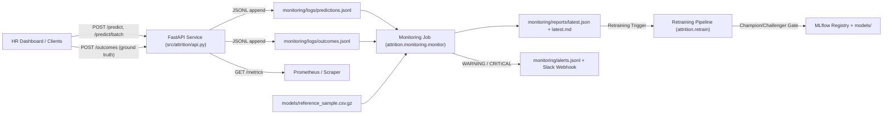

# Monitoring Setup & Retraining Strategy
**Milestone 4 · Tasks 3 & 4** | Project NHA-5-153 (`employee-attrition-classifier`)

This document is the operational runbook for tracking the deployed attrition-risk model in production, responding to drift/performance alerts, and triggering safe model updates or rollbacks.

---

## 1. Architecture & Data Flow



### Real-Time Telemetry (`/metrics`)
The FastAPI service exposes Prometheus-compatible metrics on `GET /metrics`:
- `attrition_http_requests_total{path, status}` — request volume and HTTP error rates (`422` validation failures, `503` degraded state).
- `attrition_request_latency_seconds` — histogram across 9 buckets (`5 ms` to `2.5 s`).
- `attrition_predictions_total{risk_level}` — live counts of `Low`, `Medium`, and `High` risk predictions.
- `attrition_mean_predicted_probability` — running mean predicted probability since service start.
- `attrition_outcomes_total` — count of ground-truth outcomes recorded via `POST /outcomes`.
- `attrition_model_info{version}` & `attrition_uptime_seconds` — active model version and process uptime.

---

## 2. Monitoring Checks & Alert Thresholds

All thresholds live in [`params.yaml`](../params.yaml) under `monitoring:` so they are version-controlled alongside the code.

| Category | Check | Metric / Test | Warning Threshold | Critical Threshold |
|---|---|---|---|---|
| **Freshness** | `model_age` | Days since `card["trained_at"]` | `> 90 days` | — |
| **Traffic** | `traffic_volume` | Predictions vs. previous equal window | `< 50%` of prior window (when prior $\ge 200$) | — |
| **Data Quality** | `data_quality` | Share of rows with missing or out-of-range features | `> 1%` | `> 5%` |
| **Feature Drift** | `feature_drift:TenureYears` | PSI + 2-sample KS test | $\text{PSI} \ge 0.10$ **and** $p < 0.001$ | $\text{PSI} \ge 0.25$ **and** $p < 0.001$ |
| **Feature Drift** | `feature_drift:MonthlySalary` | PSI + 2-sample KS test | $\text{PSI} \ge 0.10$ **and** $p < 0.001$ | $\text{PSI} \ge 0.25$ **and** $p < 0.001$ |
| **Feature Drift** | `feature_drift:PerformanceRating` | PSI + $\chi^2$ test | $\text{PSI} \ge 0.10$ **and** $p < 0.001$ | $\text{PSI} \ge 0.25$ **and** $p < 0.001$ |
| **Prediction Drift** | `prediction_drift:high_risk_share` | Observed vs. expected 20% High-risk share (binomial test) | $|\Delta| \ge 0.05$ **and** $p < 0.001$ | $|\Delta| \ge 0.10$ **and** $p < 0.001$ |
| **Prediction Drift** | `prediction_drift:score_distribution` | PSI + 2-sample KS on predicted probabilities | $\text{PSI} \ge 0.10$ **and** $p < 0.001$ | $\text{PSI} \ge 0.25$ **and** $p < 0.001$ |
| **Risk Surge** | `prediction_drift:recent_surge` | Last 24 h vs. earlier in window (Welch $t$-test) | $\Delta \ge +0.02$ **and** $p < 0.001$ | — |
| **Performance** | `performance:roc_auc` | Live ROC-AUC 95% bootstrap CI (requires $\ge 300$ labels) | $\text{CI}_{\text{high}} < \text{base} - 0.02$ | $\text{CI}_{\text{high}} < \text{base} - 0.04$ or $< 0.52$ |
| **Calibration** | `performance:calibration` | Observed attrition rate vs. mean predicted probability | $|\Delta| \ge 0.05$ **and** $p < 0.001$ | — |

> **Why combine PSI with a hypothesis test?** With small windows, a noisy KS $p$-value can fire falsely; with huge windows, a tiny meaningless shift can yield $p < 10^{-6}$. Requiring **both** an effect size ($\text{PSI} \ge 0.10$) and statistical significance ($p < 0.001$) prevents alert fatigue.

### Running & Scheduling Monitoring
- **One-off check (last 7 days):**
  ```bash
  python -m attrition.monitoring.monitor --window-hours 168
  ```
- **Continuous sidecar (used in `docker-compose.yml`):**
  ```bash
  python -m attrition.monitoring.monitor --window-hours 168 --watch 3600
  ```
- **CI / Cron schedule:** [`.github/workflows/monitor.yml`](../.github/workflows/monitor.yml) runs daily at `06:00 UTC` with `--fail-on critical` and uploads `monitoring/reports/` as workflow artifacts.
- **Alert delivery:** Every `WARNING` and `CRITICAL` check is appended to `monitoring/alerts.jsonl`. Setting the environment variable `ALERT_WEBHOOK_URL` sends formatted alerts to Slack (or any Slack-compatible incoming webhook).

### Verifying Monitoring with Simulated Traffic
Because real attrition outcomes arrive months after scoring, [`src/attrition/monitoring/simulate.py`](../src/attrition/monitoring/simulate.py) lets operators test all three regimes on held-out test records:
```bash
python -m attrition.monitoring.simulate --scenario stable           # baseline: all checks OK
python -m attrition.monitoring.simulate --scenario covariate_shift  # hiring wave + pay freeze -> feature & prediction drift
python -m attrition.monitoring.simulate --scenario concept_drift    # drivers flip -> ROC-AUC & calibration alerts
python -m attrition.monitoring.monitor --window-hours 168
```

---

## 3. Model Retraining Strategy

Retraining is implemented in [`src/attrition/retrain.py`](../src/attrition/retrain.py) and follows a **trigger → train challenger → statistical gate → archive & promote** lifecycle.

### 3.1 Retraining Triggers
Running `python -m attrition.retrain` checks three triggers automatically (any one triggers a retrain):
1. **Monitoring alert:** `recommend_retraining: true` in `monitoring/reports/latest.json` (triggered by any `CRITICAL` drift/performance check, or a `WARNING` on `performance:roc_auc`).
2. **Scheduled staleness:** Model age exceeds `max_model_age_days` (`90` days — quarterly cadence).
3. **Volume of new ground truth:** At least `min_new_labels` (`1,000`) newly labelled outcomes recorded via `POST /outcomes` since `trained_at`.

Use `--force` to override triggers (e.g., after a known compensation restructuring or new HR data source), or `--dry-run` to evaluate a challenger without promoting it.

### 3.2 Champion / Challenger Promotion Gate
When triggered, `retrain.py` merges the original cleaned dataset with labelled production feedback, runs a stratified hold-out split, evaluates the candidate models (`lr_core3`, `lr_engineered`, `hgb_engineered`), and compares the best **challenger** against the current **champion** using paired bootstrap resampling (`500` iterations) on identical hold-out rows:

1. **Improvement check (`improves_enough`):** $\Delta\text{AUC} = \text{AUC}_{\text{challenger}} - \text{AUC}_{\text{champion}} \ge +0.002$ (evaluated on recent feedback rows when $\ge 300$ exist in the hold-out, otherwise on the full hold-out).
2. **Non-inferiority check (`not_worse_overall`):** The 95% bootstrap CI lower bound on the full hold-out satisfies $\text{CI}_{\text{low}} \ge -0.010$.
3. **Data validation:** Combined training data must pass `validate_training_frame` (no nulls, valid feature bounds, both classes present).

If **both** gates pass (and `--dry-run` is not set):
- The current champion is archived to `models/archive/<model_id>/`.
- The challenger is registered in MLflow (`employee-attrition-classifier`) and assigned the `champion` alias.
- `models/attrition_model.joblib`, `models/model_card.json`, and `models/reference_sample.csv.gz` are updated atomically with `parent_model_id` recorded for lineage.

### 3.3 One-Command Rollback
If a newly promoted model misbehaves in production, restore the previous archived champion immediately:
```bash
python -m attrition.retrain --rollback
```
Then restart the API container (`docker compose restart api`) so it reloads `models/attrition_model.joblib`.
