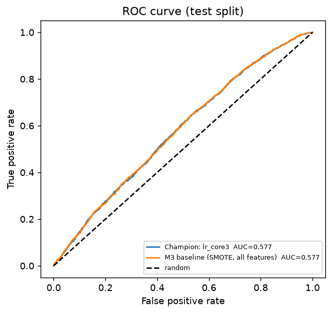
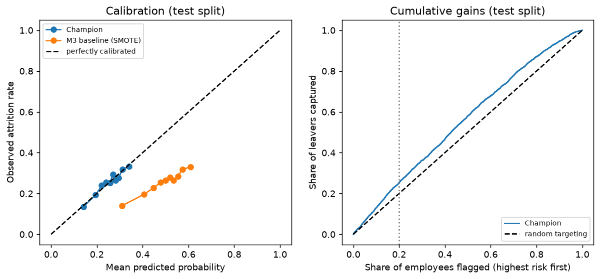
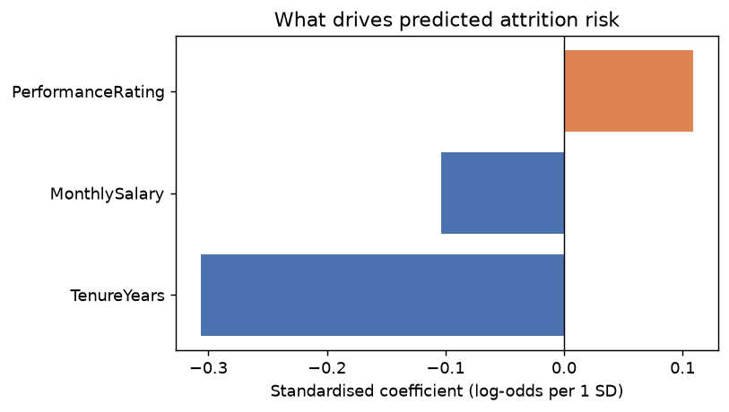

# MLOps, Deployment & Monitoring Report
**Milestone 4** | Project NHA-5-153 — Employee Attrition Prediction & Analysis

> Reproducible pipeline: `python -m attrition.train` (tracked by MLflow & DVC)  
> Serving: FastAPI (`src/attrition/api.py`) + Streamlit HR Dashboard (`src/attrition/dashboard.py`)  
> Operations runbook: [`docs/Monitoring_and_Retraining.md`](../docs/Monitoring_and_Retraining.md)

---

## 1. Pre-Deployment Audit of Milestones 2 & 3

Before deploying the model, we audited the teammates' Milestone 2 and Milestone 3 deliverables on `origin/main` from both a data-science and software-engineering perspective.

### 1.1 Milestone 2 Audit Summary

| Artifact | Status | Key Findings |
|---|---|---|
| `notebooks/04_statistical_analysis.ipynb` + `reports/Data_Analysis_Report.md` | **Pass** | Rigorous hypothesis tests (Welch $t$, Mann-Whitney $U$, $\chi^2$, ANOVA, logistic LR) with Holm correction and effect sizes. Confirmed only `TenureYears`, `MonthlySalary`, and `PerformanceRating` carry signal. |
| `notebooks/05_feature_selection.ipynb` | **Pass (minor repo clutter)** | Correlation, RFE, and permutation importance independently confirmed `TenureYears` (+0.058 AUC), `MonthlySalary` (+0.012), and `PerformanceRating` (+0.012) are the only positive contributors; `JobRole`, `Age`, `Gender` are $\le 0$. Duplicate extensionless file `notebooks/05_feature_selection` exists in repo. |
| `notebooks/Feature Engineering & Transformation.ipynb` → `transformed_hr_dataset.csv` | **Needs production fix** | Uses Colab `files.upload()`, computes `SalaryBand` with `pd.qcut` on the **entire** dataset (minor train/test leakage and impossible to reproduce identically at single-row serving time), and retains 24 one-hot columns including uninformative `Gender`/`JobRole`/`Age`. |
| `notebooks/Advanced_Visualization_&_Interactive_Dashboards.ipynb` | **Pass (cell order bug)** | Cells 4–7 reference `df['Attrition_Label']` before it is defined in Cell 10 (only works if run out of order in Colab). |

### 1.2 Milestone 3 Audit Summary

| Check | Status | Details |
|---|---|---|
| Model selection & CV | **Pass (methodology)** | Compared Logistic Regression, Random Forest, Gradient Boosting, and XGBoost with Stratified 5-Fold CV and SMOTE inside `imblearn.Pipeline` (no CV leakage). |
| **Issue 1: No persisted model artifact** | **Blocking for M4** | `Milestone3_Model_Development.ipynb` never saved a `.joblib`/`.pkl` model, scaler, or preprocessing pipeline. Additionally, `notebooks/Milestone3_Model_Development.ipynb` is an empty 2-byte placeholder while the real notebook sits at repo root. |
| **Issue 2: SMOTE hurt calibration & tree models** | **Fixed in M4** | Applying SMOTE to a 25.6% minority class degraded Logistic Regression Brier score from `0.1873` → `0.2447` (predicted probabilities clustered around ~0.50 instead of ~0.256) and broke tree thresholds (Gradient Boosting recall `0.000`, XGBoost recall `0.0016`, Random Forest AUC dropped to `0.523`). |
| **Issue 3: Over-aggressive threshold tuning** | **Fixed in M4** | Lowering the probability threshold to `0.4393` pushed Recall to `87.5%` but dropped Accuracy to `38.6%` (`5,706` false positives out of `7,294` stayers) for an F1 of `0.4215` — barely above the trivial "flag everyone" F1 of `0.4073`. |
| **Issue 4: Ignored M2 feature selection** | **Fixed in M4** | Kept all 24 features including `Gender`, `Age`, and `JobRole` despite M2 showing zero signal and fairness risks. |
| **Data quality finding** | **Documented** | `TenureYears` reaches 55 (18 rows $> 40$), and 660 rows (1.35%) have `TenureYears > Age - 16`. Model validation bounds were set to `[0, 60]` years and documented as a data-source limitation. |

### 1.3 Data Ceiling Verification
An independent benchmark confirmed that the ~0.58 ROC-AUC ceiling is a **property of the dataset**, not a modeling bug: unregularized/regularized Logistic Regression, Histogram Gradient Boosting, Random Forest, and XGBoost all plateau at `0.575`–`0.581` CV ROC-AUC. Therefore, the deployed system is explicitly designed and communicated as a **calibrated risk-ranking tool** (top-20% risk band captures `1.27×` more leavers than random targeting), not a binary hire/fire classifier.

---

## 2. MLOps Architecture & Experiment Tracking

### 2.1 Reproducible Package & Configuration
All production code is structured as an installable Python package (`pyproject.toml`, `src/attrition/`) with a single source of truth for hyperparameters, risk percentiles, drift thresholds, and retraining gates in [`params.yaml`](../params.yaml).

- **Training/serving parity:** [`src/attrition/features.py`](../src/attrition/features.py) implements a stateless scikit-learn `FeatureEngineer` transformer inside the `Pipeline`, eliminating the `pd.qcut` leakage and skew from Milestone 2.
- **Data versioning & pipeline DAG:** [`dvc.yaml`](../dvc.yaml) defines the `train` and `monitor` stages with tracked dependencies (`employee_attriton_data_clean.csv`, `params.yaml`, source files) and outputs (`models/`, `reports/mlops/metrics.json`). Every training run also logs the SHA-256 hash of the training CSV and the current Git commit.

### 2.2 MLflow Experiment Tracking & Model Registry
[`src/attrition/train.py`](../src/attrition/train.py) logs every run to MLflow (`employee-attrition` experiment, SQLite backend `mlflow.db` + artifact store `mlartifacts/`):
- **Parent run:** dataset metadata, split config, champion test metrics + 95% bootstrap CI, risk thresholds, diagnostic figures, candidate comparison table, and `model_card.json`.
- **Nested candidate runs:** 6 candidates evaluated on identical Stratified 5-Fold CV splits (including a faithful Milestone 3 baseline for direct comparison).
- **Model Registry:** Champion registered as `employee-attrition-classifier` (version `1`, alias `champion`) with an inferred MLflow model signature and input example.

### 2.3 Candidate Comparison & Champion Selection
Selection rule (`choose_champion`): highest CV ROC-AUC among deployable models; ties within `selection_tolerance = 0.002` break in favor of lower complexity (parsimony).

| Model | CV ROC-AUC | Fold Std | CV PR-AUC | CV Brier | CV Lift @ Top 20% | Complexity |
|---|---:|---:|---:|---:|---:|---:|
| **`lr_core3` (Champion)** | **0.5810** | 0.0116 | **0.3046** | **0.1871** | 1.2525 | 1 |
| `lr_engineered` | 0.5806 | 0.0116 | 0.3042 | 0.1871 | 1.2490 | 2 |
| `m3_baseline_lr_smote_all_features` *(ref)* | 0.5806 | 0.0115 | 0.3042 | 0.2442 | 1.2435 | 5 |
| `xgb_engineered` | 0.5800 | 0.0109 | 0.3032 | 0.1872 | 1.2590 | 4 |
| `hgb_engineered` | 0.5792 | 0.0093 | 0.3013 | 0.1873 | 1.2415 | 3 |
| `rf_engineered` | 0.5626 | 0.0087 | 0.2891 | 0.1890 | 1.1627 | 3 |

**Champion Held-Out Test Performance (`model_id: v20261125-181258`, `n = 9,800`):**
- **ROC-AUC:** `0.5774` (95% bootstrap CI: `0.5653` – `0.5884`) vs. M3 baseline `0.5770`.
- **Brier Score:** `0.1873` vs. M3 baseline `0.2447` (**23.4% calibration improvement** by removing SMOTE).
- **Top-20% Risk Band:** Precision `32.45%` (vs. `25.57%` base rate), Recall `25.38%`, **Lift `1.27×`**.
- **Risk Band Thresholds** (derived from OOF training probabilities): **High** $\ge 30.25\%$ (top 20%), **Medium** $\ge 26.30\%$ (next 30%), **Low** $< 26.30\%$ (bottom 50%).

---

## 3. Model Deployment

### 3.1 Real-Time REST API (`src/attrition/api.py`)
Built with **FastAPI + Pydantic v2 + Uvicorn**:
- Strict schema validation (`extra="forbid"` rejects unused/protected fields like `gender` or `age`; numeric bounds enforce `TenureYears ∈ [0, 60]`, `PerformanceRating ∈ [1, 5]`, `MonthlySalary ∈ (0, 100000]`).
- Endpoints:
  - `GET /health` — liveness & model load status (`503` if artifacts are missing).
  - `GET /model/info` — serves the full `models/model_card.json`.
  - `POST /predict` — single-employee score with `request_id`, risk band, and model-agnostic what-if `top_drivers`.
  - `POST /predict/batch` — batch scoring up to `5,000` employees per call.
  - `POST /outcomes` — ground-truth feedback ingestion joined by `request_id`.
  - `GET /metrics` — Prometheus text exposition (request counts, latency histogram, risk-band mix, mean probability, uptime).
  - `GET /monitoring/report` — latest JSON report from the monitoring job.
- Optional `X-API-Key` authentication when `API_KEY` is configured.
- Every prediction is appended to `monitoring/logs/predictions.jsonl` (thread-safe).

### 3.2 Interactive HR Dashboard (`src/attrition/dashboard.py`)
Built with **Streamlit + Plotly**, offering four tabs:
1. **Check an employee:** interactive form, risk gauge colored by Low/Medium/High bands, actionable HR guidance, and horizontal bar chart of per-feature risk drivers.
2. **Batch scoring:** CSV upload with automatic schema/range validation, risk-tier KPI cards, ranked table, and downloadable `scored_employees.csv`.
3. **Monitoring:** live status summary, check table, daily predicted risk & High-risk share time series, recent alerts, and an on-demand "Run monitoring now" button.
4. **Model:** test metrics, risk-band policy, documented limitations, and expandable full model card.

### 3.3 Containerization & CI/CD
- **[`Dockerfile`](../Dockerfile):** non-root `python:3.12-slim` image with built-in `/health` `HEALTHCHECK`.
- **[`docker-compose.yml`](../docker-compose.yml):** orchestrates 4 services sharing `./monitoring`: `api` (`:8000`), `dashboard` (`:8501`, configured to score via `API_URL=http://api:8000`), `monitor` (hourly drift/performance sidecar), and `mlflow` (`:5000`).
- **[`.github/workflows/ci.yml`](../.github/workflows/ci.yml):** runs the 40-test `pytest` suite and verifies the Docker image builds on every push/PR.
- **[`.github/workflows/monitor.yml`](../.github/workflows/monitor.yml):** scheduled daily monitoring run at `06:00 UTC` that uploads reports and fails on `CRITICAL` alerts.

---

## 4. Monitoring & Retraining Summary

Full thresholds, alert routing, and rollback commands are documented in [`docs/Monitoring_and_Retraining.md`](../docs/Monitoring_and_Retraining.md).

- **Verified via simulation:** All three regimes (`stable`, `covariate_shift`, `concept_drift`) were tested end-to-end on held-out test data:
  - `stable`: `overall_status = ok`, `0` alerts, `recommend_retraining = False`.
  - `covariate_shift`: catches `CRITICAL` feature drift on `TenureYears` and `MonthlySalary` plus `prediction_drift:high_risk_share`, emits alerts, and sets `recommend_retraining = True`.
  - `concept_drift`: inputs remain `ok` while `performance:roc_auc` fires `CRITICAL` and `performance:calibration` fires `WARNING`, setting `recommend_retraining = True`.
- **Safe retraining (`src/attrition/retrain.py`):** combines original training data with labelled production feedback, requires a paired-bootstrap AUC gain $\ge +0.002$ and non-inferiority $\text{CI}_{\text{low}} \ge -0.010$ before promotion, archives the previous champion to `models/archive/<model_id>/`, and supports instant `python -m attrition.retrain --rollback`.
- **Automated verification:** `40/40` unit and integration tests pass in `pytest` covering feature engineering, API contracts, auth, logging, Prometheus metrics, drift math, all three monitoring scenarios, webhook alerting, retraining gates, dry-run, and rollback.
